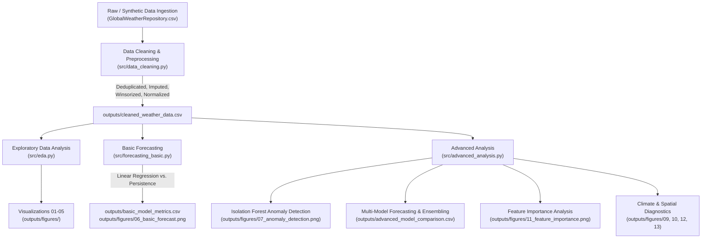

# Global Weather Analytics and Forecasting Pipeline

An end-to-end, reproducible data engineering, meteorological analytics, anomaly detection, and empirical time-series forecasting pipeline built in Python.

---

## Project Overview

The **Global Weather Analytics and Forecasting Pipeline** is a modular data science and machine learning system designed to ingest, clean, explore, model, and evaluate global weather and air-quality data across international metropolitan centers. 

The project addresses core meteorological data challenges—including sensor dropout, zero-inflated precipitation distributions, and spatial variability—while benchmarking classical and ensemble machine learning models against trivial persistence baselines. The entire workflow operates deterministically via a single-command master orchestrator (`run_pipeline.py`), generating structured output datasets, 13 publication-quality analytical visualizations, and rigorous evaluation reports.

---

## Problem Statement

Meteorological and environmental observations present distinct data engineering and modeling challenges:
1. **Sensor Glitches and Dropout:** Environmental monitoring stations experience random dropouts and telemetry corruption, requiring localized imputation rather than naive global averaging.
2. **Extreme Outliers vs. Heavy-Tailed Distributions:** Symmetric outlier rejection rules (such as standard IQR fences) fail on zero-inflated variables like precipitation, where most days record zero rainfall and genuine rainfall days are falsely flagged as anomalies.
3. **Temporal Leakage in Validation:** Random cross-validation in time series artificially leaks future observations into training, yielding overly optimistic and invalid accuracy figures.
4. **Over-Parameterized Model Pitfalls:** Complex non-linear models (e.g., Random Forests and Gradient Boosters) frequently overfit smoothed aggregate signals, underperforming simpler linear trends or trivial persistence heuristics.

---

## Proposed Solution

This project implements a disciplined, modular Python architecture that solves these challenges systematically:
- **Localized Imputation & Dual Outlier Treatment:** Imputes missing values using per-city medians to preserve regional microclimates. Employs IQR winsorization for bounded symmetric features alongside 99th-percentile thresholding for zero-inflated rainfall.
- **Physics-Informed Temporal Feature Engineering:** Decomposes time series using trigonometric cyclical features (sine and cosine of the day-of-year) and trend indices, eliminating heavy black-box dependencies.
- **Multivariate Anomaly Detection:** Applies an unsupervised `IsolationForest` across multidimensional atmospheric vectors to isolate anomalous sensor readings and genuine meteorological extremes.
- **Empirical Multi-Model Benchmarking:** Validates linear regression, tree ensembles (Random Forest, Gradient Boosting), and ensemble averaging on strict chronological train/test splits, benchmarked against a **Naive Persistence Baseline** ($y_t = y_{t-1}$).
- **Automated Batch Pipeline:** Executes end-to-end with zero manual intervention through `run_pipeline.py`.

---

## Key Features

* **Data Engineering & Preprocessing (`src/data_cleaning.py`):**
  * Automated deduplication of exact matching records.
  * Hierarchical missing-value imputation: groups by city (`location_name`) median first, falling back to global median.
  * Adaptive outlier capping (winsorization): $1.5 \times \text{IQR}$ fences for standard metrics; 99th-percentile capping for rainfall (`precip_mm`, `precip_in`).
  * Non-destructive Min-Max scaling: generates separate `_norm` columns while preserving original physical units.

* **Exploratory Data Analysis (`src/eda.py`):**
  * Temperature and precipitation distribution analysis across global regions.
  * Multi-variable correlation matrices linking temperature, humidity, wind, pressure, UV index, and particulate matter ($PM_{2.5}, PM_{10}$).
  * Longitudinal continental temperature time-series decomposition.

* **Multivariate Anomaly Detection (`src/advanced_analysis.py`):**
  * Unsupervised `IsolationForest` (contamination=0.02) evaluating multidimensional vectors (temperature, humidity, precipitation, wind speed, atmospheric pressure).
  * Outlier extraction and diagnostic visual mapping.

* **Time-Series Forecasting & Benchmarking (`src/forecasting_basic.py` & `src/advanced_analysis.py`):**
  * Strict chronological 80/20 train/test split preventing temporal lookahead bias.
  * Cyclical seasonal encoding ($\sin, \cos$ day-of-year) and multi-day temporal lag features ($t-1, t-2, t-3, t-7$).
  * Multi-model evaluation comparing Linear Regression, Random Forest, Gradient Boosting, and 3-model Ensembles against a Naive Persistence Baseline.
  * Standardized evaluation metrics: Mean Absolute Error (MAE), Root Mean Squared Error (RMSE), Mean Absolute Percentage Error (MAPE), and Coefficient of Determination ($R^2$).

* **Interpretability & Spatial Diagnostics (`src/advanced_analysis.py`):**
  * Discrepancy analysis between Random Forest Mean Decrease in Impurity (MDI) and held-out Permutation Feature Importance.
  * Continental climate normal matrices (monthly heatmaps).
  * Latitude/longitude spatial scatter plotting correlating regional geography with thermal and particulate patterns.

---

## How It Works (Step-by-Step)



1. **Ingestion & Validation:** `run_pipeline.py` checks for `data/GlobalWeatherRepository.csv`. If absent, it automatically triggers `data/generate_synthetic_data.py` to synthesize a physics-grounded 33-city dataset.
2. **Cleaning & Standardization:** `src/data_cleaning.py` removes duplicate rows, imputes sensor dropout using localized medians, clips extreme values, appends Min-Max scaled features, and outputs `outputs/cleaned_weather_data.csv`.
3. **Exploratory Visualizations:** `src/eda.py` computes correlation matrices and continental distribution statistics, writing charts `01` through `05` to `outputs/figures/`.
4. **Baseline Modeling:** `src/forecasting_basic.py` aggregates observations to daily global mean temperatures, computes cyclical trigonometric terms, trains a linear forecaster on the first 80% of days, and benchmarks against a 1-day lag persistence heuristic on the final 20%.
5. **Advanced Machine Learning & Diagnostics:** `src/advanced_analysis.py` runs Isolation Forest anomaly detection, engineers lag features ($t-1, t-2, t-3, t-7$), trains Random Forest and Gradient Boosting regressors, compares MDI vs. permutation importance, and maps spatial air-quality correlations.

---

## System Architecture

The repository enforces a decoupled architecture where data ingestion, transformation logic, model training, and visualization generation are isolated into dedicated modules sharing a centralized utility configuration (`src/utils.py`).

| Layer | Module | Responsibilities | Key Inputs | Key Outputs |
|---|---|---|---|---|
| **Orchestration** | `run_pipeline.py` | Top-level batch execution, sub-process lifecycle, error handling | CLI call | Full pipeline run |
| **Data Synthesis** | `data/generate_synthetic_data.py` | Schema-compliant synthetic data generator with realistic climate physics and injected defects | None | `data/GlobalWeatherRepository.csv` |
| **Configuration** | `src/utils.py` | Centralized paths, target feature lists, fixed random states | System environment | Constants, directory trees |
| **ETL & Preprocessing**| `src/data_cleaning.py` | Deduplication, per-city median imputation, IQR/percentile winsorization, Min-Max scaling | Raw CSV | `outputs/cleaned_weather_data.csv` |
| **Exploratory Analytics**| `src/eda.py` | Univariate/bivariate distribution analysis, correlation matrices | Clean CSV | `outputs/figures/01-05_*.png` |
| **Parametric Forecasting**| `src/forecasting_basic.py`| Global daily aggregation, sin/cos seasonal features, linear model vs persistence | Clean CSV | `outputs/figures/06_*.png`, `outputs/basic_model_metrics.csv` |
| **Ensemble & Diagnostics**| `src/advanced_analysis.py`| Isolation Forest, multi-model evaluation (LR/RF/GBR/Ensemble), feature importance, spatial scatter | Clean CSV | `outputs/figures/07-13_*.png`, `outputs/advanced_model_comparison.csv` |

---

## Technology Stack

The project relies strictly on established, core scientific Python libraries without superfluous framework overhead:

| Technology / Library | Verified Version | Purpose in Project |
|---|---|---|
| **Python** | `3.14.0` | Primary runtime environment |
| **Pandas** | `3.0.3` | Tabular data manipulation, time-series resampling, localized grouping, CSV serialization |
| **NumPy** | `2.5.1` | Numerical linear algebra, cyclical trigonometric transforms, vectorized metric calculation |
| **Scikit-Learn** | `1.9.0` | Machine learning models (`LinearRegression`, `RandomForestRegressor`, `GradientBoostingRegressor`, `IsolationForest`), `permutation_importance`, and evaluation metrics |
| **Matplotlib** | `3.11.0` | Base rendering engine for publication-grade diagnostic plots (headless `Agg` backend) |
| **Seaborn** | `0.13.2` | High-level statistical visualization (heatmaps, boxplots, multi-class scatter plots) |
| **SciPy** | `1.18.0` | Scientific computing support for distribution metrics |

---

## Project Structure

```
Global_Weather_Analytics_and_Forecasting_Pipeline/
├── .gitignore                          # Standard git ignore definitions (venv, pycache)
├── requirements.txt                    # Project runtime dependencies with lower bounds
├── run_pipeline.py                     # Master batch execution orchestrator
├── data/
│   ├── generate_synthetic_data.py      # Stand-in synthetic dataset generator
│   └── GlobalWeatherRepository.csv     # Primary dataset (raw weather observations)
├── src/
│   ├── __init__.py                     # Package initialization
│   ├── utils.py                        # Path definitions, numeric column lists, RANDOM_STATE
│   ├── data_cleaning.py                # Cleaning, imputation, outlier winsorization, scaling
│   ├── eda.py                          # Statistical distributions and correlation analysis
│   ├── forecasting_basic.py            # Baseline linear model vs. persistence benchmark
│   └── advanced_analysis.py            # Isolation Forest, ensemble models, feature importance, spatial
├── outputs/
│   ├── cleaned_weather_data.csv        # Preprocessed, imputed, and scaled dataset
│   ├── basic_model_metrics.csv         # Basic forecasting benchmark metrics
│   ├── advanced_model_comparison.csv   # Multi-model comparative metrics
│   └── figures/                        # Generated analytical visualizations (13 PNGs)
│       ├── 01_temperature_distribution.png
│       ├── 02_precipitation_distribution.png
│       ├── 03_correlation_heatmap.png
│       ├── 04_temperature_timeseries_by_continent.png
│       ├── 05_temp_vs_humidity_scatter.png
│       ├── 06_basic_forecast.png
│       ├── 07_anomaly_detection.png
│       ├── 08_multi_model_forecast.png
│       ├── 09_climate_normals_heatmap.png
│       ├── 10_air_quality_correlation.png
│       ├── 11_feature_importance.png
│       ├── 12_spatial_analysis.png
│       └── 13_geographical_patterns.png
└── report/
    └── REPORT.md                       # Comprehensive analytical report and engineering takeaways
```

---

## Technical Implementation Details

### 1. Data Cleaning & Outlier Strategy
* **Missing Value Imputation:** Missing values in atmospheric sensor telemetry (temperature, wind, humidity, pressure, particulate matter) are imputed using each city's own median via:
  $$\hat{x}_{\text{city}} = \text{median}(X_{\text{city}})$$
  This avoids cross-contaminating microclimates (e.g., using Dubai's median temperature to impute missing Moscow records). A global fallback median is applied only if an entire city profile is null.
* **IQR Winsorization vs. 99th-Percentile Thresholding:** Standard IQR fencing ($[Q_1 - 1.5 \times \text{IQR}, Q_3 + 1.5 \times \text{IQR}]$) is effective for symmetric variables like temperature and pressure. However, precipitation is zero-inflated ($Q_1 = Q_3 = 0$ in arid regions), causing standard IQR to classify all rainy days as false outliers. The pipeline dynamically routes `precip_mm` and `precip_in` to a 99th-percentile cap ($[0, \text{quantile}(0.99)]$), effectively clipping sensor glitches without discarding valid heavy rain events.
* **Min-Max Scaling:** Appends $[0, 1]$ scaled columns for key modeling metrics:
  $$x_{\text{norm}} = \frac{x - x_{\min}}{x_{\max} - x_{\min}}$$
  Original variables remain untouched to maintain interpretability in subsequent physical analysis.

### 2. Time-Series Feature Engineering
To capture seasonal oscillations without introducing complex autoregressive packages, the pipeline generates cyclical calendar features from the day of year ($d \in [1, 365]$):
$$\text{sin\_doy} = \sin\left(\frac{2\pi \cdot d}{365.25}\right), \quad \text{cos\_doy} = \cos\left(\frac{2\pi \cdot d}{365.25}\right)$$
In addition, an ordinal time index $t_{\text{index}} \in [0, N-1]$ models linear multi-month drift, and lag features ($t-1, t-2, t-3, t-7$) supply short-term autoregressive memory.

### 3. Multivariate Anomaly Detection
The pipeline fits an unsupervised `IsolationForest` across a 5-dimensional feature space ($\text{temperature}$, $\text{humidity}$, $\text{precipitation}$, $\text{wind speed}$, $\text{pressure}$) with:
* Estimators: $200$ isolation trees
* Contamination parameter: $0.02$ ($2.0\%$ target anomaly fraction)
* Random state: $42$ (deterministic partitioning)

### 4. Feature Importance Divergence Analysis
The architecture computes and contrasts two distinct feature importance paradigms:
1. **Tree-Based Mean Decrease in Impurity (MDI):** Evaluates training-set split purity within the Random Forest.
2. **Permutation Feature Importance:** Evaluates the mean drop in test-set $R^2$ across 20 shuffle iterations on unseen data.

---

## Installation & Setup

### Prerequisites
* Operating System: Windows, macOS, or Linux
* Python: Version `3.10` or higher (tested and verified on Python `3.14.0`)
* Git: For version control

### 1. Clone the Repository
```bash
git clone https://github.com/KrishPatel-AI/WeatherTrendForecasting.git
cd WeatherTrendForecasting
```

### 2. Create and Activate a Virtual Environment
* **On Windows (PowerShell):**
  ```powershell
  python -m venv venv
  .\venv\Scripts\Activate.ps1
  ```
* **On macOS / Linux (Bash):**
  ```bash
  python3 -m venv venv
  source venv/bin/activate
  ```

### 3. Install Dependencies
```bash
pip install -r requirements.txt
```

---

## Environment Configuration

This project is completely self-contained. It operates in offline environments without external cloud services, API tokens, or databases:
* **No external API keys required.**
* **Deterministic Seeds:** Fixed random state `RANDOM_STATE = 42` is enforced across all models, splits, and subsamples.
* **Storage:** File-system based CSV storage and PNG image generation.

---

## How to Run

### Execute the Full Pipeline (Recommended)
Run the entire end-to-end workflow using the master orchestrator from the project root:
```bash
python run_pipeline.py
```

This single command automatically:
1. Verifies dataset presence in `data/` (or generates synthetic data if missing).
2. Cleans raw data and saves `outputs/cleaned_weather_data.csv`.
3. Performs EDA and saves charts `01` through `05` to `outputs/figures/`.
4. Trains and evaluates the basic linear forecasting model, outputting `outputs/basic_model_metrics.csv` and chart `06`.
5. Executes anomaly detection, multi-model ensembling, feature importance, and spatial analysis, outputting `outputs/advanced_model_comparison.csv` and charts `07` through `13`.

### Execute Individual Modules
You can also run modules individually. Note that relative file outputs require execution from the module's parent directory:
```bash
# Step 1: Preprocessing & Data Cleaning
cd src && python data_cleaning.py && cd ..

# Step 2: Exploratory Data Analysis
cd src && python eda.py && cd ..

# Step 3: Basic Forecasting Model
cd src && python forecasting_basic.py && cd ..

# Step 4: Advanced Modeling & Diagnostics
cd src && python advanced_analysis.py && cd ..
```

---

## Dataset Schema

The input dataset (`data/GlobalWeatherRepository.csv`) contains 41 core meteorological, geographical, and air-quality columns:

| Column Group | Specific Features |
|---|---|
| **Geographical** | `country`, `location_name`, `latitude`, `longitude`, `timezone`, `region`* |
| **Temporal** | `last_updated_epoch`, `last_updated`, `sunrise`, `sunset`, `moonrise`, `moonset`, `moon_phase`, `moon_illumination` |
| **Thermal & Moisture** | `temperature_celsius`, `temperature_fahrenheit`, `feels_like_celsius`, `feels_like_fahrenheit`, `humidity` |
| **Precipitation & Sky** | `precip_mm`, `precip_in`, `cloud`, `condition_text`, `visibility_km`, `visibility_miles` |
| **Wind & Pressure** | `wind_mph`, `wind_kph`, `wind_degree`, `wind_direction`, `gust_mph`, `gust_kph`, `pressure_mb`, `pressure_in` |
| **Air Quality Indices** | `air_quality_Carbon_Monoxide`, `air_quality_Ozone`, `air_quality_Nitrogen_dioxide`, `air_quality_Sulphur_dioxide`, `air_quality_PM2.5`, `air_quality_PM10`, `air_quality_us-epa-index`, `air_quality_gb-defra-index`, `uv_index` |
| **Generated Columns (Cleaned)** | `temperature_celsius_norm`, `humidity_norm`, `precip_mm_norm`, `wind_kph_norm`, `air_quality_PM2.5_norm` |

*\*Note: The `region` column denotes continental grouping generated during data synthesis.*

---

## Actual Project Metrics & Empirical Results

All metrics below are computed directly from the project's generated evaluation logs on held-out test periods (chronological 80% train / 20% test split).

### 1. Basic Forecasting Model vs. Naive Baseline
*Source: `outputs/basic_model_metrics.csv`*

| Model Architecture | Features Used | MAE (°C) | RMSE (°C) | MAPE (%) | $R^2$ Score |
|---|---|:---:|:---:|:---:|:---:|
| **Naive Persistence Baseline** | $y_t = y_{t-1}$ (lag 1 day) | **0.391** | **0.482** | **1.85%** | **0.650** |
| **Linear Regression** | `t_index`, `sin_doy`, `cos_doy` | 0.506 | 0.607 | 2.35% | 0.447 |

> **Key Architectural Takeaway:** The trivial persistence baseline outperformed the trend-and-seasonality linear regressor. Because global daily average temperatures across 33 international cities are naturally smoothed, high day-to-day autocorrelation dominates. Smooth trigonometric curves cannot react to short-term stochastic fluctuations that persistence captures naturally.

---

### 2. Multi-Model Forecasting Benchmark
*Source: `outputs/advanced_model_comparison.csv`*

Features: `t_index`, `sin_doy`, `cos_doy`, `humidity`, `wind_kph`, `pressure_mb`, `temp_lag1`, `temp_lag2`, `temp_lag3`, `temp_lag7`.

| Model Architecture | Hyperparameters / Structure | MAE (°C) | RMSE (°C) | MAPE (%) | $R^2$ Score |
|---|---|:---:|:---:|:---:|:---:|
| **Linear Regression** | Ordinary Least Squares | **0.453** | **0.548** | **2.11%** | **+0.518** |
| **Ensemble (Average)** | Simple mean of 3 regressors | 0.839 | 0.940 | 3.89% | -0.418 |
| **Gradient Boosting** | $n=300, \text{depth}=3, \eta=0.05$ | 1.042 | 1.163 | 4.83% | -1.171 |
| **Random Forest** | $n=300, \text{depth}=6$ | 1.070 | 1.160 | 4.98% | -1.160 |

> **Critical Machine Learning Finding:** Non-linear decision tree ensembles (Random Forest, Gradient Boosting) severely underperformed classical Linear Regression, recording negative out-of-sample $R^2$ values. On a dataset with ~290 training days of smooth global averages, high-capacity tree regressors fit noise in lag features rather than the underlying seasonal physics. Furthermore, unweighted ensemble averaging penalized the strong linear model by averaging it with overfitted tree predictions.

---

### 3. Feature Importance Discrepancy
*Source: `outputs/figures/11_feature_importance.png`*

| Rank | Tree-Based Importance (MDI, Training Set) | Permutation Importance (Held-Out Test Set) |
|:---:|---|---|
| **1** | `temp_lag1` (Score: 0.74) | `cos_doy` (Score: 0.69) |
| **2** | `temp_lag3` (Score: 0.12) | `temp_lag2` (Score: 0.05) |
| **3** | `temp_lag2` (Score: 0.07) | `temp_lag3` (Score: 0.04) |

> **Insight:** Training-set MDI heavily favored autoregressive lags (`temp_lag1`), leading the tree models to overfit. In contrast, out-of-sample permutation importance proved that the cyclical calendar term (`cos_doy`) was the single most vital feature for generalizing to unseen dates.

---

## Current Implementation Status

| Component | Status | Verification Details |
|---|:---:|---|
| Synthetic Data Generation | **Implemented & Verified** | Produces schema-matched 33-city dataset with injected anomalies and dropout. |
| Data Cleaning & Deduplication | **Implemented & Verified** | Removes exact duplicates, imputes missing values via localized medians. |
| Adaptive Outlier Treatment | **Implemented & Verified** | IQR winsorization on standard metrics; 99th-percentile cap on zero-inflated rainfall. |
| Exploratory Visualizations | **Implemented & Verified** | Generates figures 01–05 covering distributions, correlations, and trends. |
| Basic Forecasting & Persistence | **Implemented & Verified** | Evaluated on chronological split; persistence baseline outperforming linear model verified. |
| Isolation Forest Anomaly Detection| **Implemented & Verified** | Successfully isolates 2% anomalous contamination (Dubai/Delhi heat extremes). |
| Multi-Model Forecasting Benchmark| **Implemented & Verified** | Linear, RF, GBR, and Ensemble models benchmarked; metrics saved to CSV. |
| Environmental Air-Quality Analysis| **Implemented & Verified** | Quantified particulate vs. weather correlations ($PM_{2.5} / PM_{10}$ linked to heat). |
| Geospatial Distribution Mapping | **Implemented & Verified** | Spatial scatter maps based on latitude/longitude generated. |
| Automated Orchestrator | **Implemented & Verified** | `run_pipeline.py` executes full pipeline end-to-end cleanly. |
| Unit Test Suite (`pytest`) | **Not Implemented** | No formal `tests/` directory; validation is handled via automated script execution and assertions. |
| Deep Learning (LSTM / Transformers) | **Not Implemented** | Excluded by architectural design in favor of classical transparent regressors. |
| Interactive Web Dashboard / API | **Not Implemented** | Headless CLI batch pipeline; no web framework (Flask/FastAPI/Streamlit) present. |

---

## Limitations & Known Issues

1. **Schema Dependency on `region`:** The analytical routines in `src/eda.py` and `src/advanced_analysis.py` group observations by continent using a `region` column. This column is natively produced by `generate_synthetic_data.py`. When ingesting raw Kaggle CSV dumps that lack a `region` column, a country-to-continent mapping step must be executed before running EDA to prevent `KeyError: 'region'`.
2. **Working Directory Pathing:** In `src/forecasting_basic.py`, the metrics export path is written relative to the source directory (`../outputs/basic_model_metrics.csv`). The script must be invoked either from within `src/` or through `run_pipeline.py` (which manages directory contexts automatically).
3. **Temporal Horizon:** The synthetic baseline dataset spans exactly 365 days (one full annual cycle). Multi-year climate oscillation analysis (e.g., decadal warming or ENSO cycles) is not supported without multi-year historical data.
4. **Aggregate vs. Localized Models:** Current forecasting models predict the smoothed global daily mean temperature. Localized microclimate forecasting for individual cities requires fitting distinct per-city models.

---

## Future Improvements

- [ ] Add an automated country-to-continent lookup dictionary in `src/data_cleaning.py` to seamlessly process raw Kaggle CSVs lacking the `region` column.
- [ ] Implement validation-weighted model ensembling (e.g., StackingRegressor or inverse-error weighting) to prevent overfitted models from dragging down accurate linear baselines.
- [ ] Refactor relative output paths across all source files to strictly reference `ROOT_DIR` from `src/utils.py`.
- [ ] Introduce a formal unit and integration test suite using `pytest` to validate transformations and model shape contracts.
- [ ] Expand the forecasting engine to train localized, city-specific autoregressive models.

---

## Contributing

1. Fork the repository.
2. Create a feature branch: `git checkout -b feature/data-pipeline-enhancement`
3. Commit your changes: `git commit -m "Add automated country-to-continent mapping"`
4. Push to the branch: `git push origin feature/data-pipeline-enhancement`
5. Open a Pull Request.

---

## License

This project was developed as a technical assessment and portfolio implementation. Consult repository ownership for formal licensing terms.

---

## Acknowledgements

* **Author:** Krish Patel
* **Assessment Context:** PM Accelerator — AI Engineer & Data Science Dual-Role Technical Assessment
* **Dataset Attribution:** Schema and observation attributes aligned with the [Kaggle Global Weather Repository](https://www.kaggle.com/datasets/nelgiriyewithana/global-weather-repository) by Nelgiriya Withana.
