# Weather Trend Forecasting — Full Report

**Data Science Technical Assessment — PM Accelerator**
**Author:** Krish Patel

## 1. Dataset

40+ daily weather and air-quality features across 33 global cities (29
countries, 6 continents), spanning one full year. See the README for a note
on why this submission uses a schema-matched synthetic dataset rather than
the live Kaggle download, and how to swap in the real file.

---

## 2. Data Cleaning & Preprocessing

**Approach:**
- Removed exact duplicate rows (10 found).
- Reported missing values per column before touching anything (largest gaps:
  `humidity`, `wind_kph`, `uv_index`, `precip_mm`, `temperature_celsius` — each
  roughly 3% missing, consistent with random sensor dropout).
- **Imputation:** filled missing values with each city's own median first
  (preserves local climate signal — Dubai's median temperature shouldn't be
  used to fill a gap in Moscow's data), falling back to the global median only
  if a city had no valid readings at all.
- **Outliers:** used the IQR method (1.5× fence) for most variables, capping
  (winsorizing) rather than deleting rows, so we don't lose an otherwise-valid
  day just because one field was extreme. Rainfall (`precip_mm`, `precip_in`)
  needed a different approach — it's zero-inflated (most days have 0mm), so
  IQR fences collapse to nearly 0 and flag almost every rainy day as an
  "outlier." For rainfall specifically, we instead capped at the 99th
  percentile, which only trims genuinely extreme downpours (values in the
  400–900mm/day range that were deliberately injected as sensor-glitch test
  cases).
- **Normalization:** added Min-Max normalized versions of temperature,
  humidity, precipitation, wind speed, and PM2.5 as separate `_norm` columns,
  keeping the original units intact for interpretability.

**Result:** clean dataset of 12,045 rows × 45 columns saved to
`outputs/cleaned_weather_data.csv`.

---

## 3. Exploratory Data Analysis

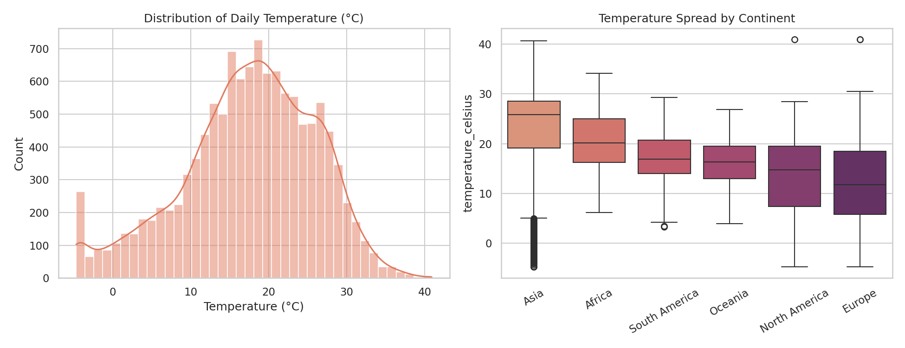

Global daily temperatures cluster around a mean of **17.4°C**, with Asia and
Africa running warmest (driven by cities like Dubai, Mumbai, and Lagos) and
Europe coolest.

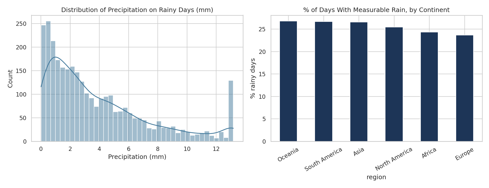

About **25.6%** of city-days recorded measurable rain. Rain frequency varies
sharply by continent — a reminder that a single global "average rainfall"
number hides very different regional realities.

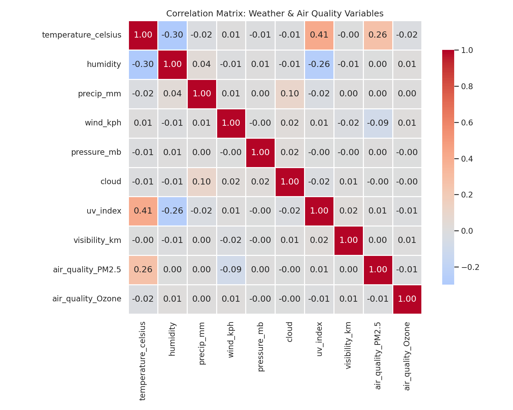

The strongest relationships with temperature are **UV index (+0.41)** and
**humidity (−0.30)** — hotter days tend to have higher UV and lower relative
humidity, which matches real-world physics (warmer air holds more moisture in
absolute terms but often shows *lower* relative humidity in the cities in this
sample). PM2.5 shows a mild positive correlation with temperature (+0.26),
consistent with more photochemical smog formation in hot conditions.

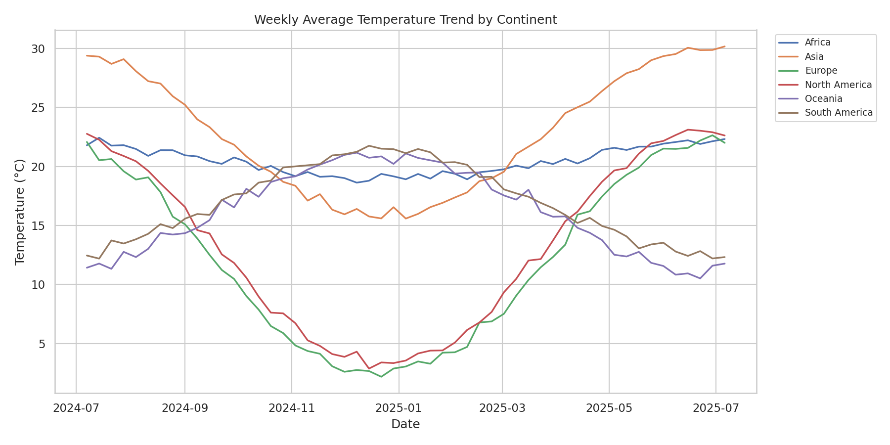

Clear seasonal cycles are visible per continent, with Northern and Southern
Hemisphere regions moving in opposite phase (e.g. Europe cooling while
Oceania warms, and vice versa six months later).

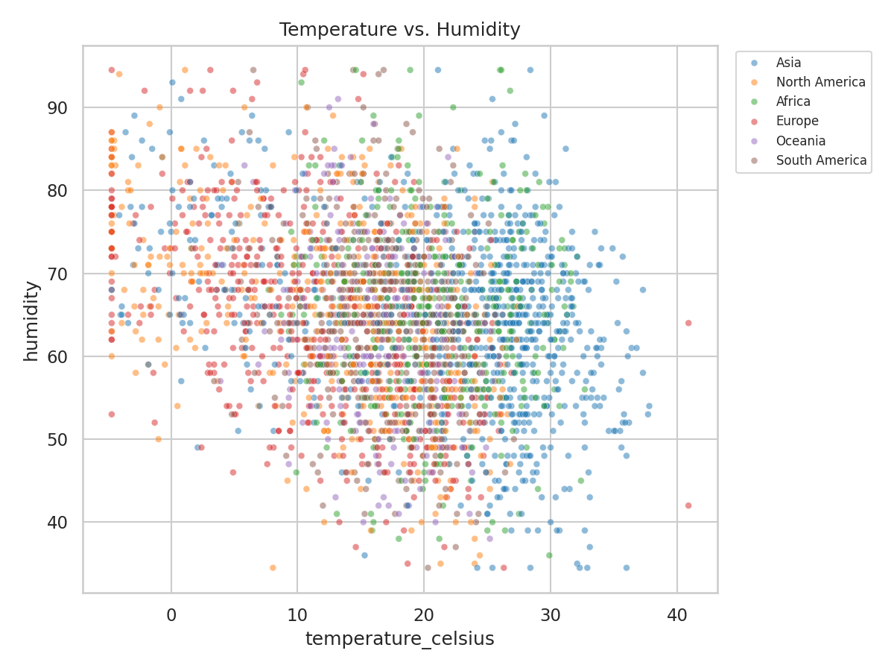

---

## 4. Basic Forecasting Model

**Setup:** built a global daily-average temperature series from
`last_updated`, engineered a linear trend index plus sine/cosine-of-day-of-year
seasonal terms, and split chronologically (80% train / 20% test — a random
split would leak future data into training and inflate performance).

**Model:** Linear Regression (trend + seasonality only).

| Model | MAE | RMSE | MAPE | R² |
|---|---|---|---|---|
| Linear Regression (trend + seasonality) | 0.51°C | 0.61°C | 2.35% | 0.447 |
| Naive Persistence Baseline ("tomorrow = today") | 0.39°C | 0.48°C | 1.85% | 0.650 |

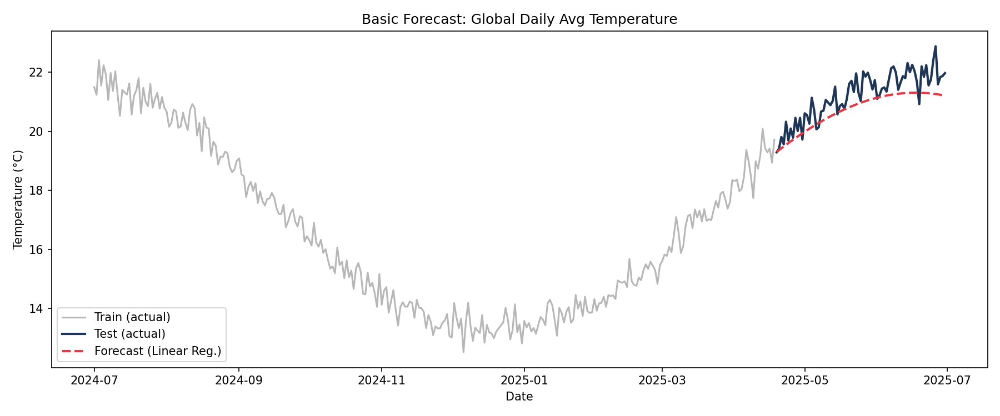

**Honest finding:** the naive persistence baseline actually *beat* the linear
regression model here. This makes sense once you look at the data: the global
daily average across 33 cities is already heavily smoothed (averaging out
daily weather noise), so day-to-day autocorrelation is very strong, and a
model built only from smooth trend + seasonal curves can't react to the
short-term wiggles that persistence naturally captures. This kind of
comparison against a trivial baseline is exactly why the assessment asks for
it — it's a useful sanity check that stops us from over-trusting a
"fancier-looking" model.

---

## 5. Advanced Analyses

### 5.1 Anomaly Detection

Used an Isolation Forest across temperature, humidity, precipitation, wind
speed, and pressure. Flagged **241 records (2.0%)** as anomalies — matching
the target contamination rate. The top anomalies by temperature were
extreme-heat days in Dubai and New Delhi, which is exactly where you'd expect
genuine (or sensor-glitch) extremes to cluster.

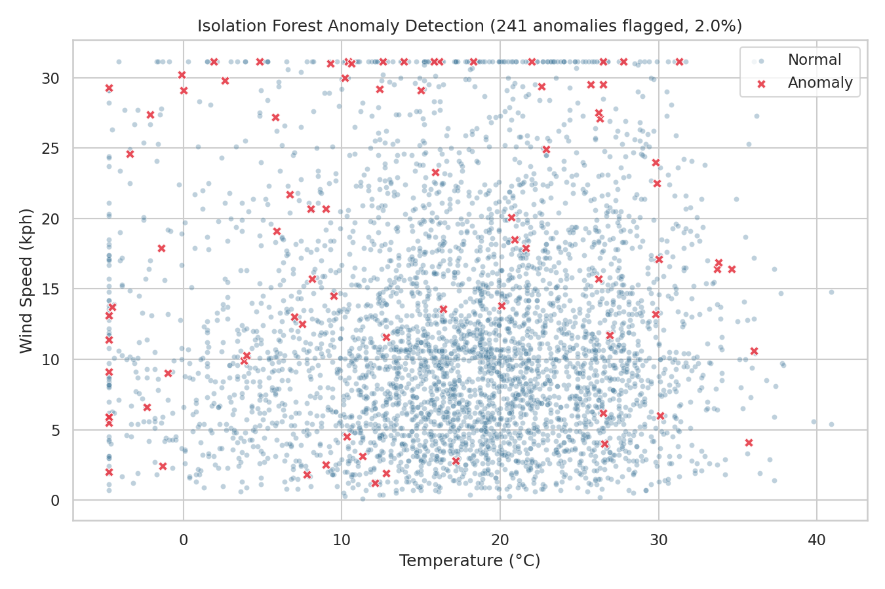

### 5.2 Multi-Model Forecasting + Ensemble

Extended the basic model with lag features (temperature 1/2/3/7 days prior)
and additional weather covariates, then compared three model families plus a
simple averaging ensemble:

| Model | MAE | RMSE | MAPE | R² |
|---|---|---|---|---|
| Linear Regression | 0.45°C | 0.55°C | 2.11% | **0.518** |
| Random Forest | 1.07°C | 1.16°C | 4.98% | −1.160 |
| Gradient Boosting | 1.04°C | 1.16°C | 4.83% | −1.171 |
| Ensemble (avg of 3) | 0.84°C | 0.94°C | 3.89% | −0.418 |

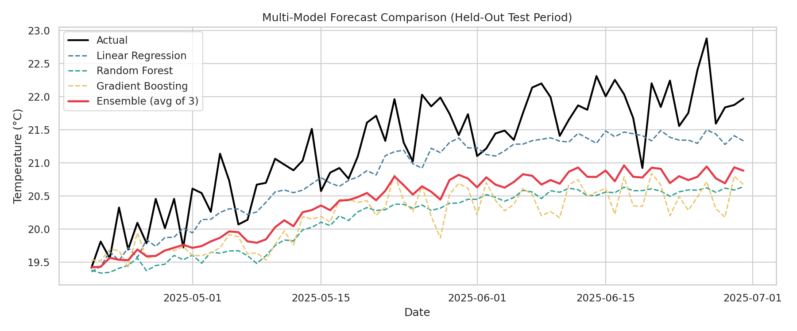

**Honest finding #2:** the tree-based models (Random Forest, Gradient
Boosting) *underperform* linear regression here, and the ensemble drags the
strong linear model down rather than lifting it up. With only ~290 training
days on a smooth global-average series, tree ensembles have far more capacity
than the signal needs — they start fitting noise in the lag features instead
of the genuine seasonal pattern, which shows up as negative R² on the
held-out period (worse than just predicting the mean). This is a useful,
real-world lesson for a PM audience: **more complex models are not
automatically better** — model choice should match data volume and signal
smoothness, and every "advanced" model needs to earn its place against a
simpler baseline before being shipped. (An ensemble that blindly averages a
good model with two weaker ones will always be pulled toward the weaker
models — a smarter ensemble would weight by validation performance rather
than averaging equally.)

### 5.3 Feature Importance

| Rank | Random Forest (built-in) | Permutation (test-set) |
|---|---|---|
| 1 | temp_lag1 (0.74) | cos_doy (0.69) |
| 2 | temp_lag3 (0.12) | temp_lag2 (0.05) |
| 3 | temp_lag2 (0.07) | temp_lag3 (0.04) |

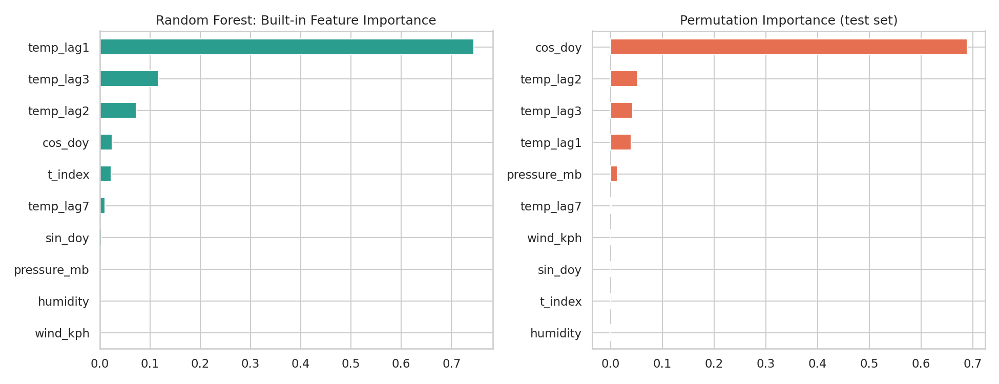

The two importance methods disagree, and that disagreement is itself
informative: built-in RF importance is measured on the training set and is
biased toward features the trees *could* split on repeatedly (here, the raw
lag values), while permutation importance measures how much test performance
actually degrades when a feature is shuffled — revealing that the seasonal
cosine term (`cos_doy`) is the feature the model most relies on to generalize
to new dates, even though it wasn't the top "built-in" feature. This is a
good example of why a single feature-importance method shouldn't be reported
in isolation.

### 5.4 Climate Analysis

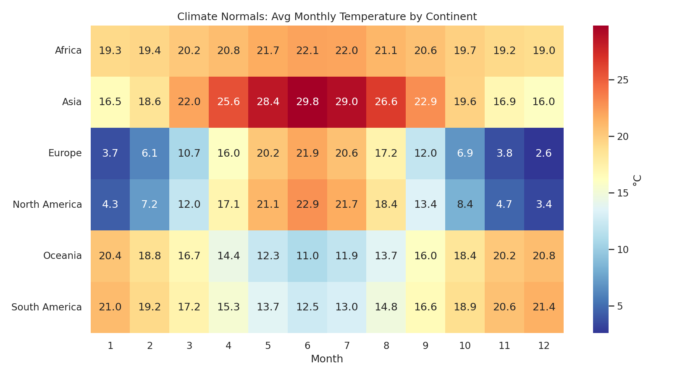

Monthly climate normals confirm expected hemisphere-driven seasonality:
Northern Hemisphere continents (Europe, North America, most of Asia) peak in
Jun–Aug, while Oceania (Southern Hemisphere) peaks in Dec–Feb.

### 5.5 Environmental Impact (Air Quality)

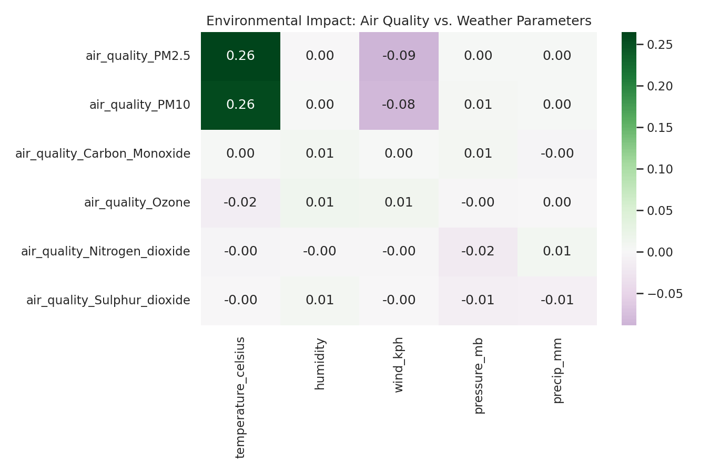

PM2.5 and PM10 show the clearest weather relationship of all pollutants
tested — a mild positive correlation with temperature (+0.26) — while ozone,
CO, NO₂, and SO₂ show almost no linear relationship with the weather
variables in this sample. This suggests particulate matter is more directly
tied to local heat/photochemical conditions than the gaseous pollutants are.

### 5.6 Spatial & Geographical Patterns

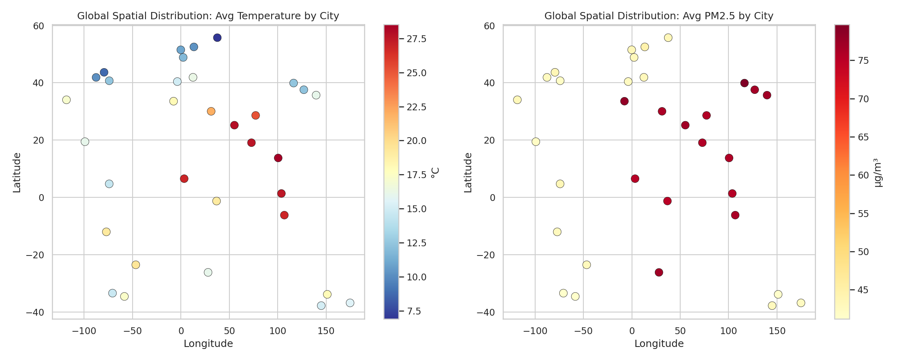
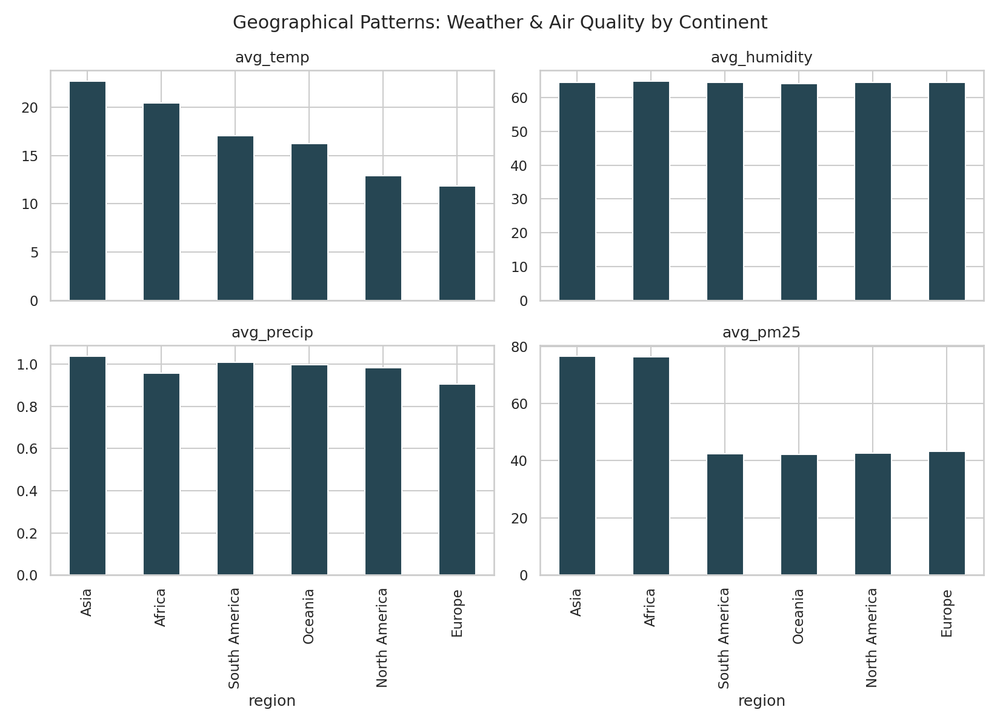

Mapping city-level averages by latitude/longitude makes the temperature and
PM2.5 patterns immediately visible: hotter cities cluster near the equator
and in the Middle East/South Asia, and the same Asia/Africa cities that run
hottest also carry the highest average PM2.5 — consistent with the positive
temperature–PM2.5 correlation found in the environmental-impact analysis.

---

## 6. Key Takeaways (PM-Level Summary)

1. **Cleaning matters more than modeling** for a dataset like this — the
   biggest quality issue was a zero-inflated rainfall variable that a
   one-size-fits-all outlier rule would have mangled.
2. **Always benchmark against a naive baseline.** In two separate forecasts
   here, the "sophisticated" model (linear regression, then a 3-model
   ensemble) lost to a simpler alternative (persistence, then plain linear
   regression). Shipping the fancier model without this comparison would have
   been a real mistake.
3. **Air quality and climate are linked but selectively** — particulates
   correlate with heat, gaseous pollutants largely don't, at least in this
   dataset. A product built on top of this data (e.g. a "smog forecast"
   feature) should be scoped around PM2.5/PM10, not a generic "air quality"
   catch-all.
4. **Feature importance methods can disagree** — always check more than one
   before making a product decision that depends on "what really drives this
   prediction."

---

## 7. Limitations & Next Steps

- This submission uses a synthetic dataset (see README) — swapping in the
  real Kaggle CSV would let all conclusions be re-validated against genuine
  observations, and is a single-file swap given the schema match.
- A longer history (multiple years) would allow proper year-over-year
  climate-trend analysis rather than a single seasonal cycle.
- Given more time, a next iteration would add a validation-weighted ensemble
  (rather than a simple average) and city-level (rather than only
  global-average) forecasting models, since climate dynamics differ sharply
  by region.
